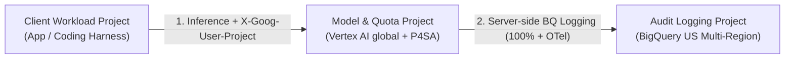

# Gemini OrangeBox — Multi-Project Vertex AI Inference & Audit Logging

[](https://shell.cloud.google.com/cloudshell/open?cloudshell_git_repo=https://github.com/BrianReevz/gemini-orangebox&cloudshell_tutorial=README.md)

Turn-key setup scripts, Terraform IaC, and SDK samples for running **global-only** Vertex AI Frontier Models across a strict three-project boundary—recording every prompt and response to an isolated, "international orange" flight-recorder BigQuery project:



## Why Three Projects?
1. **Client Workload Project** (e.g., `my-client-workload-project`): Runs your application or coding harness using local ADC. Holds **no** local model quotas or prompt logs.
2. **Model & Quota Project** (e.g., `my-model-quota-project`): Hosts the allowlisted models on the Vertex AI `global` endpoint (`aiplatform.googleapis.com`), absorbs quota/billing via `X-Goog-User-Project`, and owns the Vertex AI P4SA.
3. **Audit Logging Project** (e.g., `my-audit-logging-project`): Central compliance repository storing 100% sampled request/response logs in BigQuery (`US` multi-region).

### Important `global` Endpoint Rule
Vertex AI's `global` endpoint **cannot auto-create BigQuery datasets** and should not target a single region like `us-central1`. The BigQuery dataset must be **pre-created in the `US` multi-region** with `roles/bigquery.user` (project) and `roles/bigquery.dataEditor` (dataset) granted to the **Model & Quota Project's P4SA**. Vertex AI will then auto-create the `request_response_logging` table on the first inference call.

---

## What `cloudshell_setup.sh` Does (Before You Run It)
To keep everything transparent and easy to audit, [`cloudshell_setup.sh`](cloudshell_setup.sh) performs only these 5 actions—and prints a confirmation prompt before changing anything:
1. Enables `aiplatform.googleapis.com` and initializes the Vertex AI P4SA in your **Model & Quota Project**.
2. Enables `bigquery.googleapis.com` and creates a `US` multi-region BigQuery dataset in your **Audit Logging Project**.
3. Grants `roles/bigquery.user` (project) and `roles/bigquery.dataEditor` (scoped to that dataset) to the **Model & Quota Project's P4SA**.
4. Calls `setPublisherModelConfig` on `global` for the configured models (defaults: `gemini-4-argon-cyber-permissive`, `gemini-4-carbon-cyber-permissive`, `gemini-3.8-flash-cyber`; customizable via `MODELS_CSV`).
5. *(Optional)* Grants your **Client Caller Principal** `roles/aiplatform.user` and `roles/serviceusage.serviceUsageConsumer` on the **Model & Quota Project**.

---

## Quickstart (Cloud Shell)

Click **Open in Cloud Shell** above (or clone this repo), then run:

```bash
chmod +x cloudshell_setup.sh verify_logging.sh

# 1. Preview every command without making changes
./cloudshell_setup.sh --dry-run

# 2. Run interactively (prompts for your project IDs)
./cloudshell_setup.sh
```

> **Alternative Options:**
> - **All-in-one Python setup script**: `python3 setup_orangebox.py` (supports `--dry-run`)
> - **Modular CLI scripts**: [`scripts/01_provision_p4sa.sh`](scripts/01_provision_p4sa.sh), [`scripts/02_setup_logging_bq_iam.sh`](scripts/02_setup_logging_bq_iam.sh), [`scripts/03_configure_publisher_logging.sh`](scripts/03_configure_publisher_logging.sh)
> - **Terraform IaC**: [`terraform/`](terraform/) for Phases A, B, and Client Caller IAM, followed by [`scripts/03_configure_publisher_logging.sh`](scripts/03_configure_publisher_logging.sh) for Phase C.

---

## Verify & Test Inference

1. Run a test call from your **Client Workload Project** using local ADC:
   - **Python**:
     ```bash
     cd sdk-samples/python
     pip install -r requirements.txt
     CENTRAL_MODEL_PROJECT=<MODEL_QUOTA_PROJECT_ID> python orangebox_client.py
     ```
   - **Node.js**:
     ```bash
     cd sdk-samples/nodejs
     npm install
     CENTRAL_MODEL_PROJECT=<MODEL_QUOTA_PROJECT_ID> npm start
     ```
2. Wait 2–5 minutes for asynchronous table creation, then verify:
   ```bash
   ./verify_logging.sh
   ```
